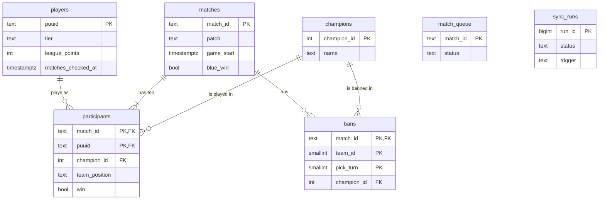

# Schema and access roles

Built from `db/schema.sql` and `db/roles.sql`.

## ER diagram

`match_queue` and `sync_runs` stand apart: they record what the sync did, not facts about the game.

## One row per table

| Table | One row means | Key |
|---|---|---|
| `players` | One player on the high-elo ladder (as of the latest run that saw them) | `puuid` |
| `champions` | One champion | `champion_id` (Data Dragon `key`) |
| `matches` | One ranked solo game where all ten players were on the ladder | `match_id` |
| `participants` | One player's performance in one game | (`match_id`, `puuid`) |
| `bans` | One ban by one team | (`match_id`, `team_id`, `pick_turn`) |
| `match_queue` | One match ID the sync discovered, and its fate: pending, stored, filtered_out, failed | `match_id` |
| `sync_runs` | One run of `ingest/sync.py` | `run_id` (identity) |

**`participants.puuid` references `players`.** That foreign key enforces the population rule: a game is stored only if all ten players are on the ladder.

**Audit columns.** `last_updated_at` moves only when a tracked value changes. Bookkeeping columns (`last_seen_on_ladder_at`, `matches_checked_at`) are updated separately, so they don't count as changes.

## Access roles

| Role | Used by | Can |
|---|---|---|
| Owner (`DATABASE_URL`) | `ingest/sync.py`, locally and in GitHub Actions | Everything. Never given to the website, the chatbot, or an AI agent. |
| `app_reader` (`APP_DATABASE_URL`) | Website, chatbot, `scripts/status.py`, `evals/check_reference.py` | `SELECT` on all seven tables, nothing else |
| `anon`, `authenticated` (Supabase Data API) | Not used | All access revoked |

Proof: `python scripts/check_reader.py` (SELECT works; INSERT into `sync_runs` and DELETE from `participants` are denied; both attempts are rolled back).
